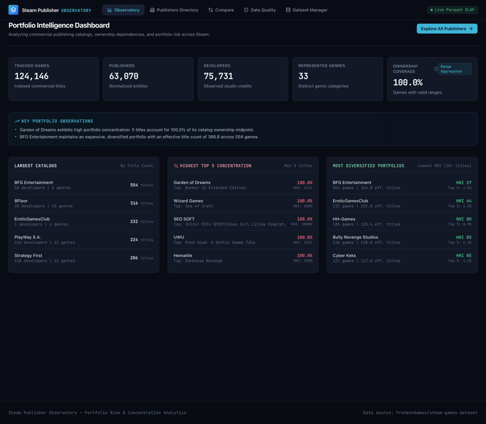
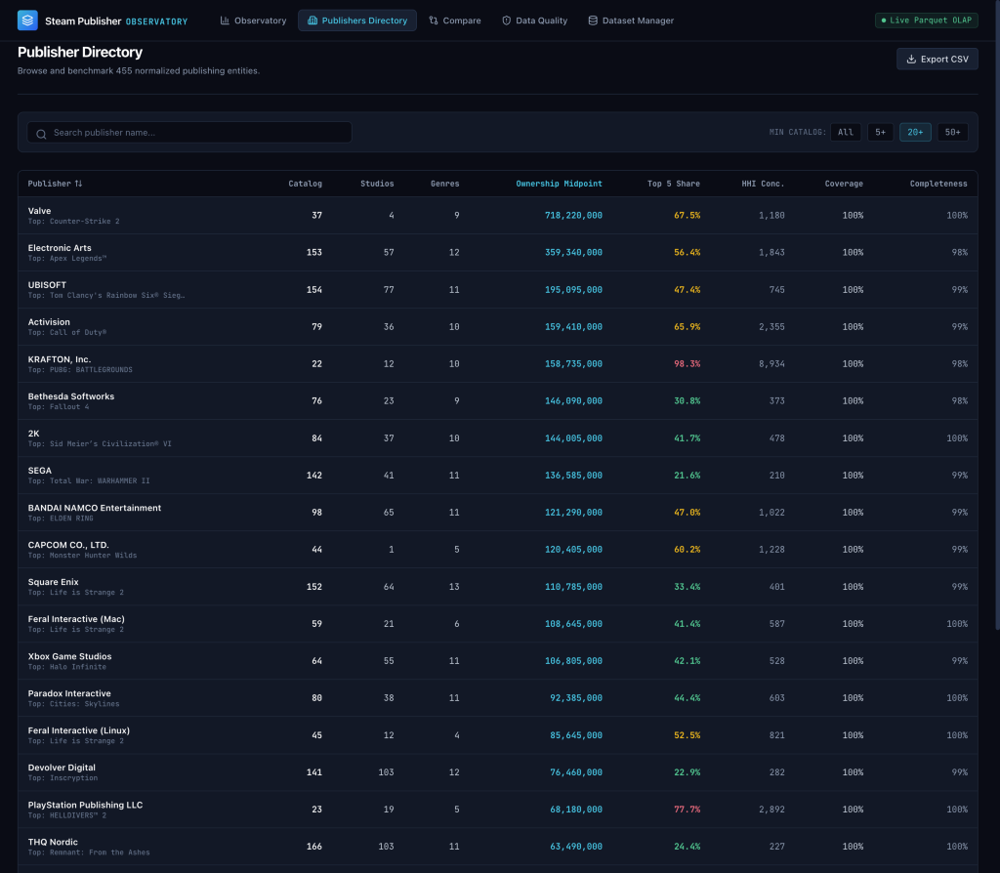
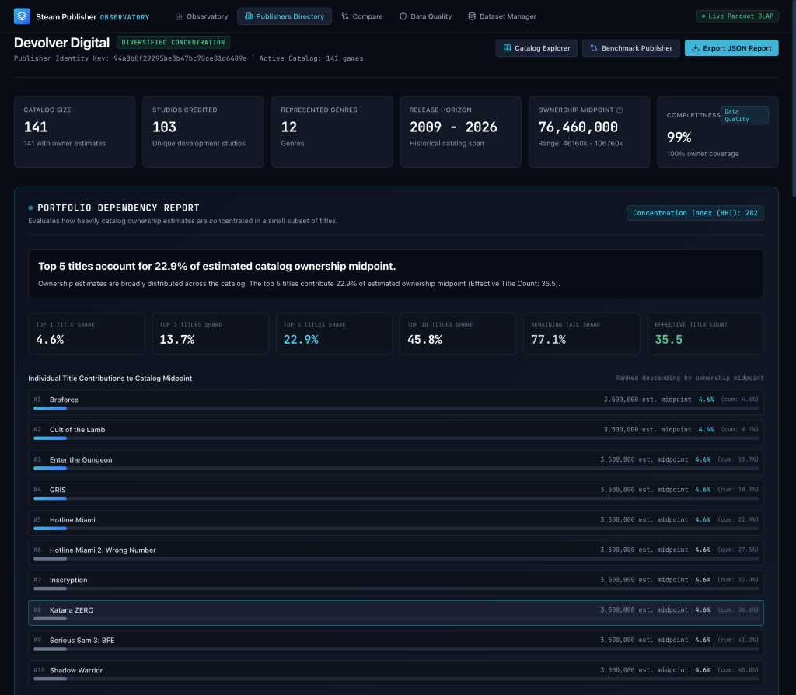
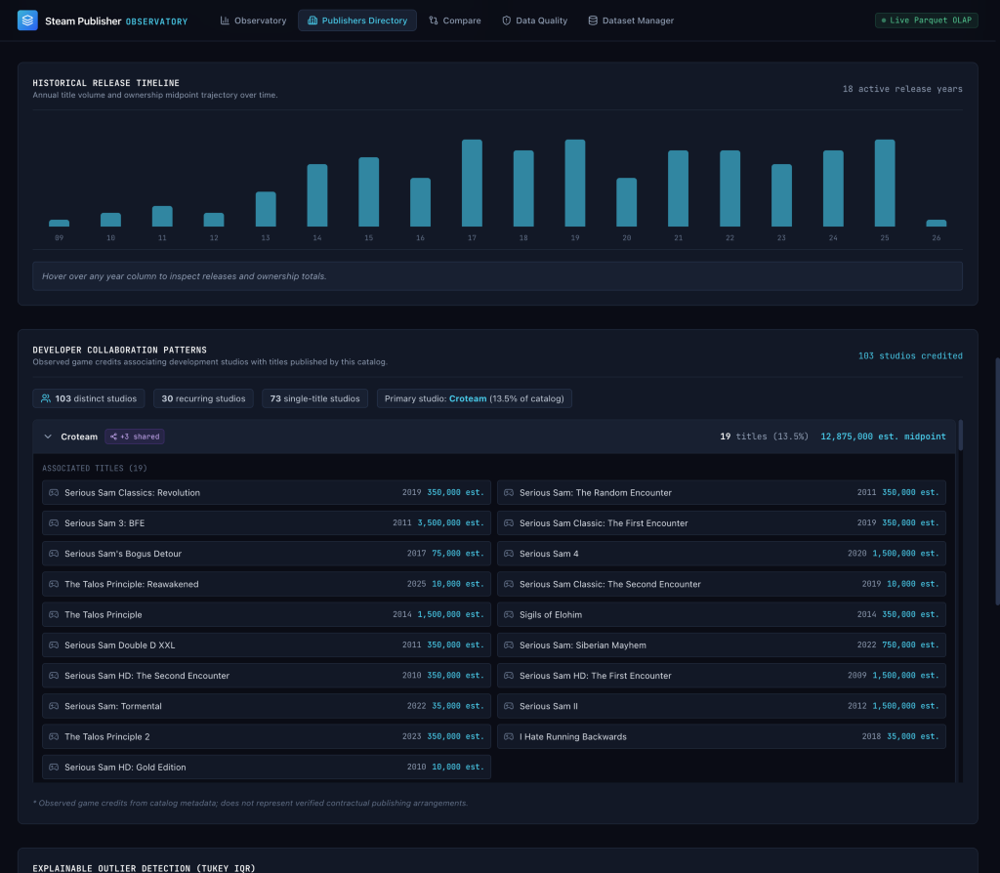
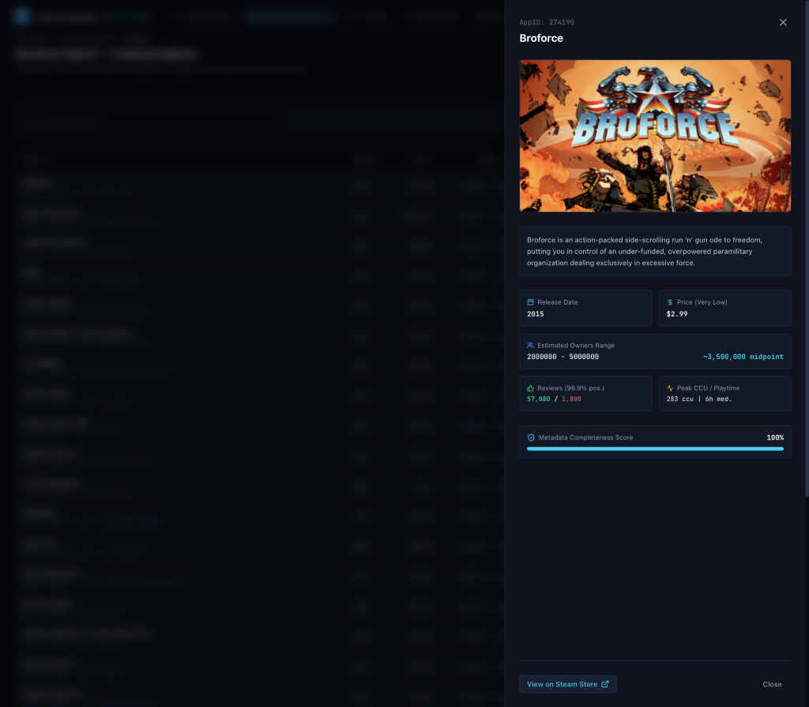
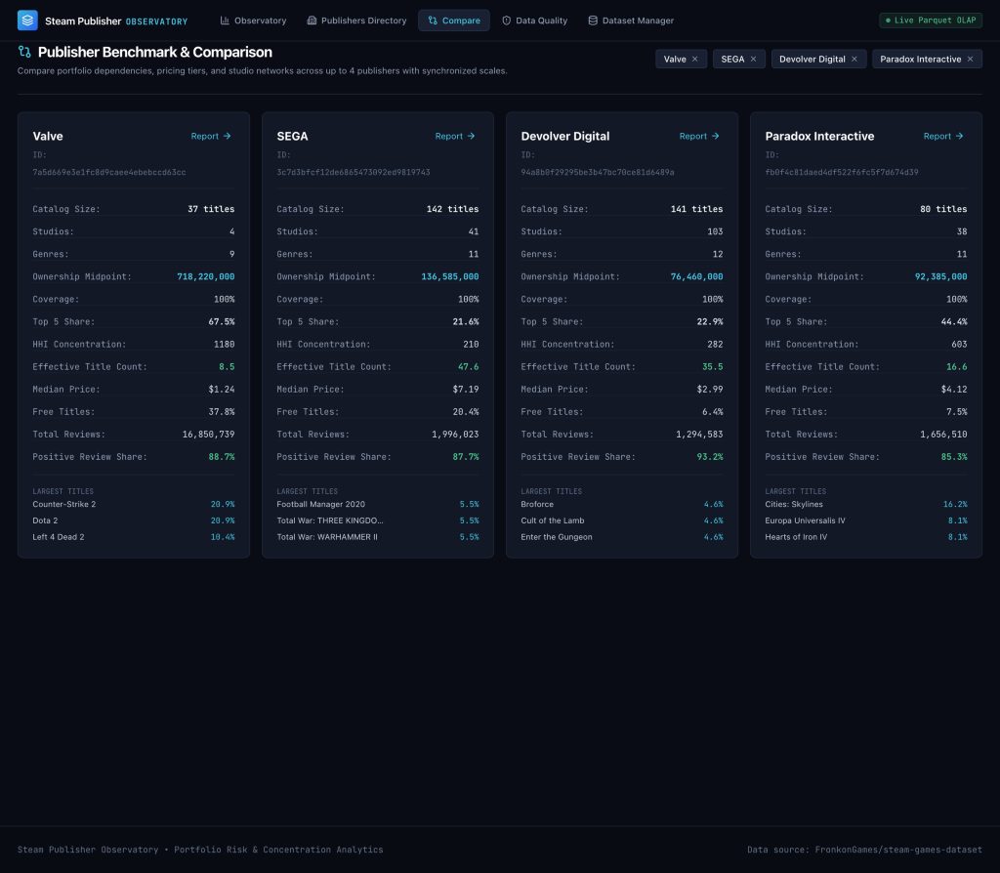
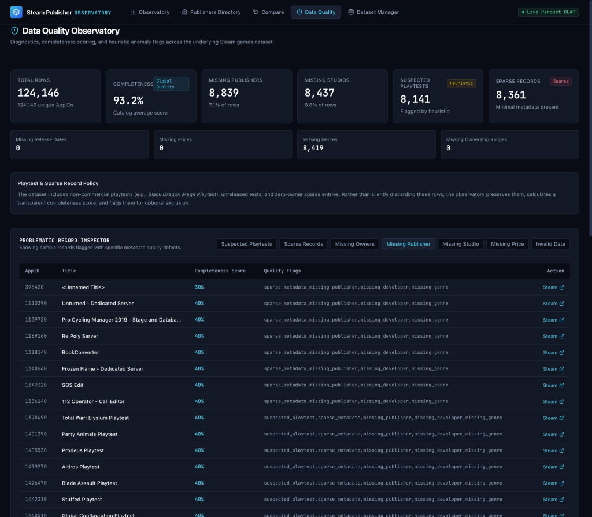
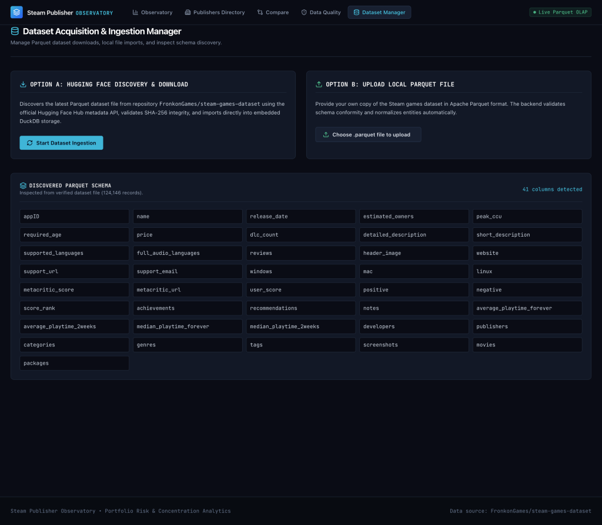

# Steam Publisher Observatory

[](./LICENSE)
[](https://golang.org)
[](https://react.dev)
[](https://www.typescriptlang.org)
[](https://duckdb.org)

**Steam Publisher Observatory** is an analytical intelligence platform evaluating video game publishers on Steam at the portfolio and corporate level. Designed for game publishers, independent studios, investors, market researchers, and video game industry analysts, it models catalog concentration, studio collaboration networks, multi-genre specialization, pricing structures, and historical release cadences across **124,146 commercial Steam titles**, **63,070 normalized publishers**, and **75,731 development studios**.



---

## Why Steam Publisher Observatory?

Most video game analytics tools evaluate titles in isolation. **Steam Publisher Observatory** shifts the analytical unit from a single game to the **publishing portfolio**, answering corporate and structural questions:

- **Concentration & Hit Dependency Risk**: Does a publisher depend on a single breakout title for 90%+ of its catalog footprint, or is its audience distributed across an effective portfolio of dozens of titles?
- **Studio Network Architecture**: Does a publisher operate through a single internal studio or partner across an external network of recurring and single-title development studios?
- **Genre & Pricing Strategy**: How is a publisher's catalog allocated across genres when multi-genre titles are weighted proportionally ($1/K$), and how are releases segmented across commercial pricing tiers?
- **Explainable Data Quality**: How much of a catalog's metadata is complete, and which entries represent non-commercial playtests or sparse records?

---

## Key Features & Analytical Capabilities

- **Portfolio Dependency Report**: Computes Top-1, Top-3, Top-5, and Top-10 ownership concentration shares, Lorenz curves, Herfindahl-Hirschman Index ($\text{HHI} \in [0, 10000]$), and Effective Title Count ($N_{\text{eff}} = 1/\sum s_i^2$).
- **Multi-Genre Proportional Allocation**: Uses $1/K$ weighted attribution for multi-genre titles so portfolio genre composition always sums to an exact `100.0%`.
- **Studio Collaboration Network**: Maps developer credits across publisher catalogs, distinguishing exclusive studio partnerships from studios shared across multiple publishers.
- **Tukey IQR Outlier Fences**: Non-parametric statistical boundaries ($Q_1 - 1.5\,\text{IQR}$, $Q_3 + 1.5\,\text{IQR}$) identifying breakout hits and statistical anomalies across ownership, positive reviews, total reviews, peak CCU, recommendations, playtime, and price.
- **Multi-Publisher Benchmarking**: Synchronized side-by-side comparison matrix for up to 4 publishers across catalog scale, concentration metrics, pricing models, and top titles.
- **Data Quality Observatory**: Transparent accounting of sparse metadata, suspected playtest builds, missing publisher/studio credits, and per-title completeness scoring.
- **Embedded Columnar OLAP Performance**: Vectorized DuckDB storage ingests and normalizes 124,146 Parquet records in ~7 seconds with sub-50ms analytical query responses and zero external database dependencies.
- **Unified Binary or Split Dev Mode**: Production Go binary serves both REST APIs and the compiled React SPA from a single process, with Vite hot-reloading proxy support for development.

---

## Product Tour & Screenshot Gallery

### 1. Publisher Directory & Portfolio Benchmarking

Search, filter by minimum catalog threshold (`5+`, `20+`, `50+` titles), and sort across 63,070 normalized publishing entities by catalog size, studios, genres, estimated ownership midpoint, Top 5 concentration share, HHI, coverage, or completeness score—with one-click CSV export.



### 2. Executive Portfolio Dependency Report

Every publisher dossier features a **Portfolio Dependency Report** quantifying reliance on top-performing titles, scaled HHI concentration classification (`Diversified`, `Moderate`, `High`), effective title count ($N_{\text{eff}}$), and an interactive ranked contribution bar stack.



### 3. Historical Release Timeline, Developer Network & Tukey IQR Outliers

Drill into annual release cadence and ownership trajectory, expand credited development studios (e.g., Croteam's 19 titles with Devolver Digital) to inspect shared publisher counts, and run non-parametric Tukey IQR outlier detection across 7 portfolio metrics.



### 4. Catalog Explorer & Game Detail Drawer

Explore a publisher's complete game catalog with search, playtest exclusion filtering, multi-column sorting, CSV export, and an interactive slide-over **Game Detail Drawer** surfacing header art, description, pricing tier, ownership range bounds, review sentiment, peak CCU, median playtime, and metadata completeness.



### 5. Side-by-Side Multi-Publisher Comparison

Benchmark up to 4 publishers side-by-side (shown below comparing **Valve**, **SEGA**, **Devolver Digital**, and **Paradox Interactive**) across catalog size, studio count, ownership midpoint, Top 5 share, HHI concentration, effective title count, median price, free title share, review sentiment, and largest catalog titles.



### 6. Data Quality Observatory

Audit global dataset completeness (`93.2%` across 124,146 records) and inspect individual records flagged by automated quality heuristics (`Suspected Playtests`, `Sparse Records`, `Missing Publisher`, `Missing Studio`).



### 7. Dataset Acquisition & Schema Inspector

Download and verify the Parquet snapshot directly from Hugging Face Hub, upload a local `.parquet` file via drag-and-drop, and inspect the 41 discovered Parquet schema columns.



---

## Quick Start

### 1. Prerequisites

- **Go**: 1.24 or later (with CGO enabled for embedded DuckDB)
- **Node.js**: 22 or later
- **pnpm**: 10 or later (`npm install -g pnpm`)

### 2. Build the Application

```bash
# Clone the repository
git clone https://github.com/LaymanMax/steam-publisher-observatory.git
cd steam-publisher-observatory

# Install dependencies and build the React frontend
cd frontend
pnpm install
pnpm build
cd ..

# Build the Go backend binary
cd backend
go build -o bin/server cmd/server/main.go
cd ..
```

### 3. Ingest Dataset (CLI or Web UI)

The platform uses the public [`FronkonGames/steam-games-dataset`](https://huggingface.co/datasets/FronkonGames/steam-games-dataset) Apache Parquet snapshot. You can trigger a one-click download from Hugging Face inside the web UI at **`/dataset`**, or run the standalone CLI ingestion tool:

```bash
cd backend
go run cmd/ingest/main.go -parquet ../data/train-00000-of-00001.parquet -db ../data/observatory.duckdb
```

Actual CLI execution output:

```text
2026/11/22 20:39:28 Connecting to DuckDB database at ../data/observatory.duckdb...
2026/11/22 20:39:28 Starting ingestion of ../data/train-00000-of-00001.parquet...
2026/11/22 20:39:28 [validating] 5.0% - Calculating file checksum and verifying Parquet structure...
2026/11/22 20:39:28 [validating] 15.0% - Parquet schema verified (41 columns, 124146 rows)
2026/11/22 20:39:28 [ingesting] 25.0% - Loading records into analytical staging...
2026/11/22 20:39:29 [normalizing] 40.0% - Normalizing publisher entities...
2026/11/22 20:39:30 [normalizing] 50.0% - Normalizing developer entities...
2026/11/22 20:39:30 [normalizing] 60.0% - Indexing relationships across publishers, developers, and genres...
2026/11/22 20:39:34 [ingesting] 70.0% - Transforming and persisting normalized game records...
2026/11/22 20:39:35 [summarizing] 85.0% - Materializing portfolio dependency indexes & analytics...
2026/11/22 20:39:35 [complete] 100.0% - Import complete! 124146 unique games, ready for observatory.

=========================================
Dataset Ingestion Succeeded in 7.623129667s
=========================================
Total Rows:              124146
Unique AppIDs:           124146
Duplicate AppIDs:        0
Invalid Records:         0
Missing Publishers:      8839
Missing Developers:      8437
Missing Genres:          8419
Missing Release Dates:   0
Missing Prices:          0
Missing Owners:          0
Suspected Playtests:     8141
SHA-256 Checksum:        775b17f2a5a52b96a8441739cd0dd4939916335b6edeebbfc4a1b238388c5a77
File Size:               183.09 MB
=========================================
```

### 4. Run the Observatory Server

```bash
# Start the unified server (serves both REST APIs and the compiled React SPA)
./backend/bin/server -port 8080 -db ./data/observatory.duckdb
```

Open **`http://localhost:8080`** in your browser.

---

## Configuration

Both `cmd/server` and `cmd/ingest` can be configured via command-line flags or environment variables:

| CLI Flag (`server`) | CLI Flag (`ingest`) | Environment Variable | Default                            | Description                                    |
| ------------------- | ------------------- | -------------------- | ---------------------------------- | ---------------------------------------------- |
| `-port`             | —                   | `PORT`               | `8080`                             | HTTP bind port                                 |
| `-host`             | —                   | `HOST`               | `127.0.0.1`                        | HTTP bind address                              |
| `-datadir`          | `-datadir`          | `DATA_DIR`           | `./data`                           | Directory for Parquet files and DuckDB storage |
| `-db`               | `-db`               | `DB_PATH`            | `./data/observatory.duckdb`        | Path to the embedded DuckDB database file      |
| —                   | `-parquet`          | —                    | `<DATA_DIR>/train-00000...`        | Path to local Parquet file for CLI ingestion   |
| —                   | —                   | `HF_REPO_ID`         | `FronkonGames/steam-games-dataset` | Hugging Face dataset repository identifier     |

---

## Architecture

```text
steam-publisher-observatory/
├── backend/
│   ├── cmd/
│   │   ├── server/          # Go HTTP Server entrypoint (-port, -host, -db, -datadir)
│   │   └── ingest/          # Standalone CLI ingestion tool (-parquet, -db, -datadir)
│   ├── internal/
│   │   ├── analytics/       # Tukey IQR outliers, aggregations, service layer
│   │   ├── api/             # Chi router, handlers, CORS, SPA static asset server
│   │   ├── comparison/      # Multi-publisher comparison matrix (up to 4 publishers)
│   │   ├── config/          # Environment & flag configuration loader
│   │   ├── database/        # Embedded DuckDB schema & connection pool
│   │   ├── dataset/         # Hugging Face Hub metadata discovery & downloader
│   │   ├── importer/        # Vectorized Parquet ingestion & data quality scoring
│   │   ├── jobs/            # Async background import job manager
│   │   ├── metrics/         # Portfolio dependency, HHI, Lorenz, 1/K genre weighting
│   │   ├── normalization/   # Entity cleaning, Unicode NFKC, alias resolution
│   │   └── reports/         # CSV streaming & JSON corporate dossier export
│   └── tests/               # Backend integration test suite
├── frontend/
│   ├── src/
│   │   ├── components/      # Custom SVG charts (Contribution, Timeline, Outlier, Tree)
│   │   ├── features/        # Feature screens (Dashboard, Directory, Report, Compare)
│   │   ├── services/        # Type-safe REST API client
│   │   ├── types/           # TypeScript data models
│   │   └── test/            # Vitest & React Testing Library test suite
│   ├── vite.config.ts       # Vite + Tailwind v4 + API dev proxy setup
│   └── package.json
├── data/                    # Parquet datasets & DuckDB storage (gitignored)
├── docs/                    # Architecture, methodology, and showcase screenshots
│   ├── screenshots/         # High-resolution application screenshots
│   ├── architecture.md
│   ├── data-dictionary.md
│   ├── metrics-methodology.md
│   └── dataset-import.md
└── README.md
```

---

## REST API Reference

| Endpoint                                     | Method     | Description                                                             |
| -------------------------------------------- | ---------- | ----------------------------------------------------------------------- |
| `/api/health`                                | `GET`      | Health check and version status.                                        |
| `/api/overview`                              | `GET`      | Platform-wide totals, top publishers, and concentration tiers.          |
| `/api/publishers`                            | `GET`      | Paginated publisher directory with search, genre, and size filters.     |
| `/api/publishers/{id}`                       | `GET`      | Publisher entity details.                                               |
| `/api/publishers/{id}/summary`               | `GET`      | Materialized portfolio summary and concentration metrics.               |
| `/api/publishers/{id}/catalog`               | `GET`      | Paginated game catalog with filters and sort orders.                    |
| `/api/publishers/{id}/dependency`            | `GET`      | Complete Portfolio Dependency Report (Top-N shares, HHI, Lorenz curve). |
| `/api/publishers/{id}/genres`                | `GET`      | Proportional $1/K$ weighted genre distribution (sums to 100%).          |
| `/api/publishers/{id}/prices`                | `GET`      | Pricing tier distribution, median/mean, free vs paid ratio.             |
| `/api/publishers/{id}/developers`            | `GET`      | Studio collaboration network and developer credits.                     |
| `/api/publishers/{id}/timeline`              | `GET`      | Annual release history and ownership midpoint growth.                   |
| `/api/publishers/{id}/outliers`              | `GET`      | Tukey IQR outlier detection across ownership, reviews, playtime, CCU.   |
| `/api/publishers/{id}/quality`               | `GET`      | Publisher-specific data quality and completeness score.                 |
| `/api/publishers/{id}/report`                | `GET`      | Aggregated corporate dossier combining all analytical dimensions.       |
| `/api/compare?publishers=id1,id2`            | `GET`      | Side-by-side benchmarking of up to 4 publishers.                        |
| `/api/dataset/status`                        | `GET`      | Ingestion status, row counts, and active download jobs.                 |
| `/api/dataset/schema`                        | `GET`      | Parquet file schema inspection (row count and column list).             |
| `/api/dataset/quality`                       | `GET`      | Global data quality diagnostics and missing field counts.               |
| `/api/dataset/issues`                        | `GET`      | Paginated list of problematic/sparse records by issue flag.             |
| `/api/entities/aliases`                      | `GET/POST` | Entity alias consolidation management.                                  |
| `/api/exports/publishers.csv`                | `GET`      | CSV export of filtered publisher directory.                             |
| `/api/exports/catalog.csv?publisher_id={id}` | `GET`      | CSV export of filtered publisher game catalog.                          |
| `/api/exports/report.json?publisher_id={id}` | `GET`      | Formatted JSON export of complete publisher report.                     |

---

## Running Automated Tests

### Backend Unit & Integration Tests

```bash
cd backend
go test -v ./...
```

Covers:

- Exact 72.0% Top-5 share synthetic dependency calculation and zero-denominator edge cases.
- Proportional $1/K$ weighted multi-genre allocation summing to `100.0%`.
- Tukey IQR fence outlier detection across normal, small-sample, and constant distributions.
- Estimated owners range parsing (en-dashes, em-dashes, unicode minus, commas, reversed bounds).
- Entity normalization, Unicode NFKC clean-name formatting, and alias consolidation with live summary recalculation.
- Full HTTP API endpoint integration tests across all 24 routes, directory sorting, and filtered CSV/JSON exports.

### Frontend Unit & Component Tests

```bash
cd frontend
pnpm test
```

Covers Vitest and React Testing Library suites for navigation bar routing, KPI stat cards, segmented pricing tier bars, ranked ownership contribution charts, and API client contracts.

---

## Methodology & Attribution Disclaimers

> **Analytical Disclaimer**: All metrics derived in Steam Publisher Observatory reflect **estimated catalog ownership ranges** and public store metadata collected from Steam. They **do NOT represent audited commercial revenue, net publisher receipts, retail units sold, profit margins, or distinct concurrent account players**.

For deeper technical details, consult the documentation in [`docs/`](./docs):

- [Architecture Guide](./docs/architecture.md)
- [Data Dictionary](./docs/data-dictionary.md)
- [Metrics & Analytical Methodology](./docs/metrics-methodology.md)
- [Dataset Acquisition & Import Guide](./docs/dataset-import.md)

---

## Contributing

Contributions, bug reports, and analytical enhancements are welcome! Please review [CONTRIBUTING.md](./CONTRIBUTING.md) and our [Code of Conduct](./CODE_OF_CONDUCT.md) before opening a pull request.

## License

This project is licensed under the [MIT License](./LICENSE).
The Steam Games Dataset is published by FronkonGames under the MIT license.
Steam and the Steam logo are trademarks of Valve Corporation. This project is not affiliated with Valve Corporation.
